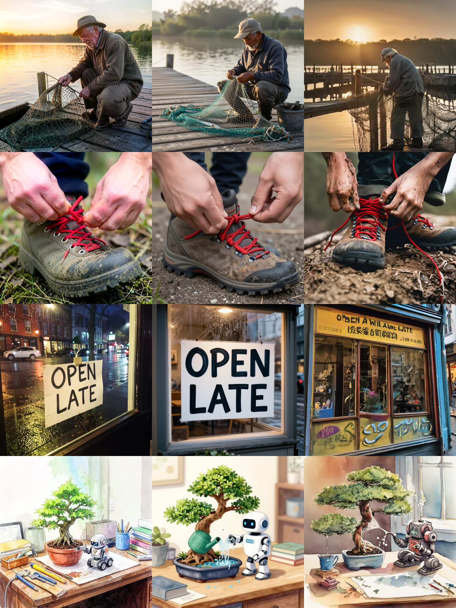
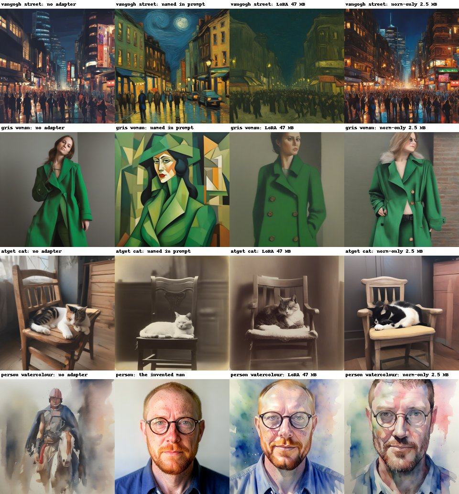
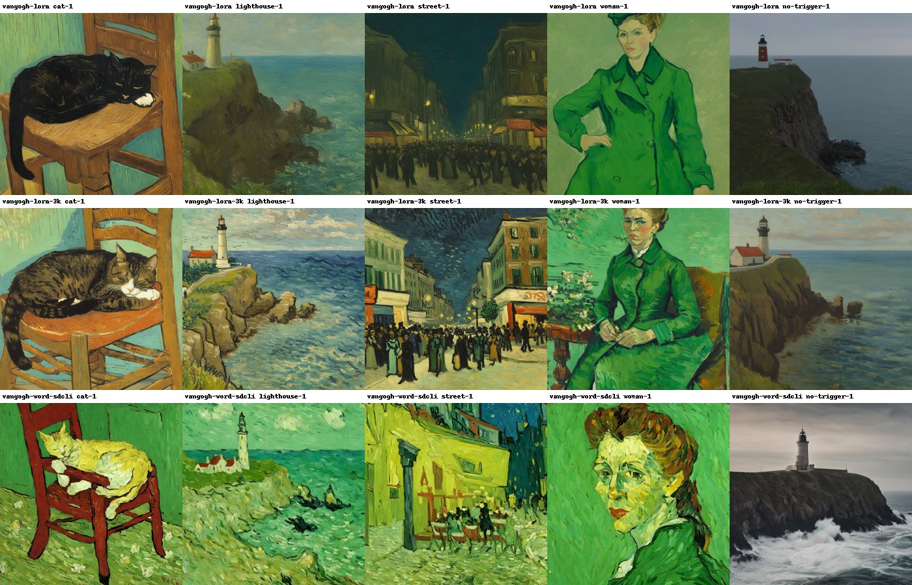

# 🖼️ Making pictures on 8 GB

Text models aren't the only thing this laptop can run. A current image model draws a 1024×1024
picture in 23 seconds in 3.5 GB of VRAM, and it can spell. Stable Diffusion was what we'd have
reached for a few years ago; it's now the slowest of the three models we tried.



*Left to right: FLUX.2 Klein 4B, Iris-3B Turbo, SDXL. Seed 1, shrunk to fit; nothing retouched.*

## The results

Four prompts × two seeds at 1024×1024, measured 2026-10-31:

| Model | Time per image | Peak VRAM | Steps | Hands | Sign text | Watercolour asked for |
|---|---:|---:|---:|---|---|---|
| **FLUX.2 Klein 4B** Q4_0 | **23 s** | **3.5 GB** | 4 | good | right on both, one doubled | yes |
| **Iris-3B Turbo** (6 GB file) | 33 s | 7.3 GB | 4 | good | right on both, cleanest | no, looks like digital cartoon |
| SDXL base | 47 s | 5.8 GB | 25 | passable, messy laces | garbled on one, spacing off on the other | yes |

Times are medians; the first run of each model was 8 to 15 s slower while files loaded. The
quality columns are our own look at the pictures, not a score.

**Pick Klein.** It's the fastest, uses half the VRAM and leaves room for a LoRA or another model.
**Iris-3B Turbo is the one for text**, but at 7.3 of 7.8 GB it leaves nothing spare. Its Q4 GGUF
should use less, which we haven't tried.

The text encoder runs on the CPU (`--backend te=cpu`), since it's needed once per prompt, and VAE
tiling is on. Iris-3B paints pixels directly, so it has no VAE at all.

## Giving it a picture as well

Prompts aren't the only input. One test of each on our own 1024×1024 fisherman, 2026-10-31:

| Input | Flag | FLUX.2 Klein 4B | Iris-3B Turbo | SDXL |
|---|---|---|---|---|
| Picture + prompt, redraw it | `-i in.png --strength 0.7` | works | works | works |
| Picture + mask + prompt, redraw one area | `-i in.png --mask mask.png` | **works, blends best** | pasted a hard square | works, slight seam |
| Reference + prompt, edit by instruction | `-r in.png` | **works** | ignored | ignored |

**Klein's reference edit is the one to use:** "wearing a red cap instead of his hat" changed the hat
and kept the man, the net and the sunset, though the face shifted a little. Iris-3B and SDXL run
with `-r` and report no error, but their picture is identical to a run without it, so an exit code
of 0 proves nothing there.

White in the mask is the area to redraw. Everything outside should stay put, and the average change
per colour value (out of 255) well outside the mask was 0.0 on Iris-3B, 2.5 on Klein and 5.9 on SDXL
([`run_inputs.py`](../bench/imagegen/run_inputs.py), [results](../bench/imagegen/results/inputs.json));
the two latent models go through a VAE, which we think explains that. At strength 0.7 the
"watercolour" request came out as a painted-looking photo, not a real restyle; lower strengths
keep more, and we only tried this one. ControlNet, IP-Adapter and PhotoMaker also have flags and
are untested.

## Run it yourself

The runner is [stable-diffusion.cpp](https://github.com/leejet/stable-diffusion.cpp), the llama.cpp
of image models. We used commit `0a067120`, cloned next to this repo:

```bash
git clone --recursive https://github.com/leejet/stable-diffusion.cpp ../stable-diffusion.cpp
git -C ../stable-diffusion.cpp checkout 0a067120b388bfefb9a87b96960cb548b97e9157
git -C ../stable-diffusion.cpp submodule update --init --recursive
mamba run -n llamacpp-cuda bash -c 'cd ../stable-diffusion.cpp && \
  cmake -B build -DSD_CUDA=ON -DCMAKE_CUDA_ARCHITECTURES=75 -DCMAKE_BUILD_TYPE=Release && \
  cmake --build build -j6'

bash scripts/download-models.sh klein kleinte kleinvae        # ~5.3 GB
python3 bench/imagegen/run_gen.py klein --quick               # one picture
python3 bench/imagegen/run_gen.py klein iris sdxl             # the table above
```

Pictures land in `models/image-gen/out/`, timings in [`bench/imagegen/results/`](../bench/imagegen/results/).
All the downloads are pinned and sha256-checked, and their audits are in
[Security](security.md#audits-so-far).

## Teaching SDXL a style or a person

**Short version: an 8 KB learned word is the best first try, for a person and for a style.** It's
strong and doesn't leak into prompts without the word, and it stacks. For famous styles, naming them
in the prompt is still free and at least as good, and 1000 steps of LoRA or norm-only fell short of
that. The first results below are by eye from two seeds (1 and 2), through diffusers rather than
`sd-cli`, so treat them as a first look, not a score. Later results are in
[The best person file is 8 KB](#the-best-person-file-is-8-kb) and
[Words on styles](#words-on-styles-and-stacking).



*Seed 1. The last row's second picture is the training reference, not a generated result. "No
adapter" uses the same prompt as the adapters, trigger word included.*

| Teaching | Pictures | Named in the prompt | LoRA | Norm-only |
|---|---|---|---|---|
| Van Gogh | 17 | Clear on both seeds | Paint and palette, without the swirling strokes | Slight, some paint texture |
| Juan Gris (cubism) | 23 | Clear on both seeds | Muted paint, no cubist shapes | Little, some odd geometry |
| Atget (old photo) | 24 | Clear on both seeds | Faded tones, sepia only sometimes | Little |
| A person | 20 | Can't: an invented man has no name | Face, hair, beard and glasses | Beard and glasses, often the face; weaker at full length |

- **The person is the surprise.** With no adapter, the same prompts give a stranger. Norm-only gets
  the round glasses and red beard on both seeds in the watercolour and chef pictures, from a file
  about 19x smaller. Neither method shows much through the astronaut's visor.
- **It went the opposite way from our guess.** We expected style to suit norm-only, because
  style-transfer research ties style to feature means and spreads. Here, it did better on the person.
- **It leaks.** Asked for just "a man on a beach", both person adapters drew a man in a blue shirt
  like the training pictures. Style adapters also change pictures without their trigger word,
  mostly darkening or muting them. Stacking a person with a style needs a test for this.
- **The fix for the person turned out to be a word.** See [below](#the-best-person-file-is-8-kb).
- **Why Gris rather than Picasso:** Picasso's work is still under copyright. We train only on public
  domain art, and the Atget photos are public domain too. The "person" is invented, drawn by Klein
  ([`make_subject.py`](../bench/imagegen/make_subject.py)).

| Method | Trainable | File | 1000 steps at 768 px | Peak VRAM |
|---|---|---|---|---|
| LoRA, rank 8 | 11.6M | 47 MB | 17 min | 5.4 GiB |
| Norm-only | 0.59M | 2.5 MB | 15.5 min | 5.3 GiB |

Both train in the 8 GB card by caching text and image encodings first. Numbers are in
[`style-runs.json`](../bench/imagegen/results/style-runs.json).

```bash
python3 bench/imagegen/fetch_commons.py        # public domain sets, listed in bench/imagegen/data/
mamba run -n vlft python bench/imagegen/train_style.py train --set vangogh --method norm --trigger vgstyl
mamba run -n vlft python bench/imagegen/train_style.py eval --run vangogh-norm --trigger vgstyl
```

### The best person file is 8 KB

Same invented man, 20 pictures, two seeds, judged by eye. Pictures for the new rows come from
`sd-cli` where marked, so they're what you'd actually run. There's no automatic likeness score yet.

| Method | File | Training | Likeness | Leaks into "a man on a beach"? |
|---|---|---|---|---|
| **Klein `-r`, no training** | one photo | none | Good, weaker at full length; both seeds look alike | n/a, only with the photo |
| **Textual Inversion, `sd-cli`** | **8 KB** | 35 min | **Strong, about level with LoRA** | **No** |
| LoRA with regularisation pictures | 45 MB | 17 min, plus making 20 pictures | Strong; one astronaut lost the face | **No** |
| LoRA, `sd-cli` | 47 MB | 17 min | Strong | Yes |
| LoRA + norm | 49 MB | 17 min | Strong, about level with LoRA | Yes |
| DoRA | 49 MB | 28 min | Strong | Yes |
| Norm-only, baked, `sd-cli` | 2.5 MB + a full checkpoint | 16 min | Beard and glasses; misses at a distance | Yes, mildly |

- **Textual Inversion wins here.** It trains one new word in both text encoders and leaves the
  drawing model alone, so without the word the model is unchanged. It's slower only because the text
  encoders run on the CPU to fit in 8 GB, and it's a little less stable: one astronaut came out as an
  illustration, one lost the face.
- **The LoRA leak has a cheap fix.** Training also on 20 plain pictures of "a man" made by the
  untouched model ([`make_reg.py`](../bench/imagegen/make_reg.py)) stopped the blue shirt and glasses
  turning up in plain prompts, at no visible cost to likeness on the beach and chef prompts. So
  the file is what's left to choose between: 8 KB, or 45 MB and half the training time.
- **Fewer steps may do.** With LoRA + norm, 250 steps (about 4 minutes) already showed the glasses
  and beard, and 500 looked close to 1000.
- **Both file types work in `sd-cli`:** our LoRA loads as it is (1120 of 1120 tensors), and
  [`bake_sdxl.py`](../bench/imagegen/bake_sdxl.py) writes norm-only into a checkpoint. A learned
  word goes in with `--embd-dir`.

### Words on styles, and stacking

The same kind of 8 KB word, on Van Gogh and Gris. It took 35 minutes each, through `sd-cli`, judged by
eye on two seeds. A 3000-step Van Gogh LoRA (50 minutes) is the comparison.



*Seed 1. The last column has no trigger word, so a changed picture there is a leak.*

| Van Gogh | File | Training | Look | Leaks? |
|---|---|---|---|---|
| Named in the prompt | none | none | Clear, swirling strokes | n/a |
| LoRA, 1000 steps | 47 MB | 17 min | Paint and palette, muted | Yes, darkens |
| **LoRA, 3000 steps** | 47 MB | 50 min | **About level with the prompt** | **Yes, strongly: a plain prompt comes out painted** |
| **Word** | **8 KB** | 35 min | Bold strokes, stronger than 1000 steps of LoRA, but everything turns green | **No** |

- **Steps mattered more than we'd assumed.** The earlier verdict that the prompt beats training was
  a verdict on 1000 steps. Three times as long closes the gap on Van Gogh, at the price of the worst
  leak we've seen. Regularisation pictures fixed the person's leak, but we haven't tried them on a style.
- **The word has a colour habit.** Van Gogh and Gris both came out green, in pictures of a cat and a
  street as well as the green coat. It isn't the starting word: starting a Van Gogh word from "art"
  instead of "painting" came out greener still. Mean green over the pictures went from 133 to 150, on
  10 of the 12 pictures (the scoring run hit its time limit). The cause is still unknown.
- **Gris didn't work as cubism.** The word gives an old oil look, stronger than LoRA, with no broken
  planes. Neither method learned the shapes, so only naming him gets them. Structure seems much
  harder to teach than paint.
- **Two words stack.** [`stack.py`](../bench/imagegen/stack.py) put `vgword style, zxqtok man` in one
  prompt, and the invented man kept his beard and glasses in Van Gogh's paint, though he also drifts
  towards Van Gogh's self-portraits. With Gris the man stayed and the style mostly went, so stacking is
  only as strong as the weaker word. All 16 pictures took about 12 minutes. Turning the style word
  down to 0.7 with `(word:0.7)` barely changed anything, so it's not a usable strength control.

```bash
mamba run -n vlft python bench/imagegen/train_style.py preflight --set subject --method norm --trigger zxq
mamba run -n vlft python bench/imagegen/invert.py --set subject --word zxqtok
mamba run -n vlft python bench/imagegen/eval_sdcli.py --run subject-word --trigger zxqtok
```

**A bug to avoid:** an SDXL VAE loaded on its own in diffusers gets SD 1.5's scaling factor, 0.18215
instead of 0.13025. Pictures come out off-colour and training quietly learns the wrong thing. It voided
our first full round of runs, so `train_style.py` now sets it explicitly.

## What's next

A person and a style stacked, DoRA and LoRA + norm on the person, a style the prompt can't name, and
LoRA on Klein. See [Faster and better fine-tuning](up-next.md#faster-and-better-fine-tuning).
