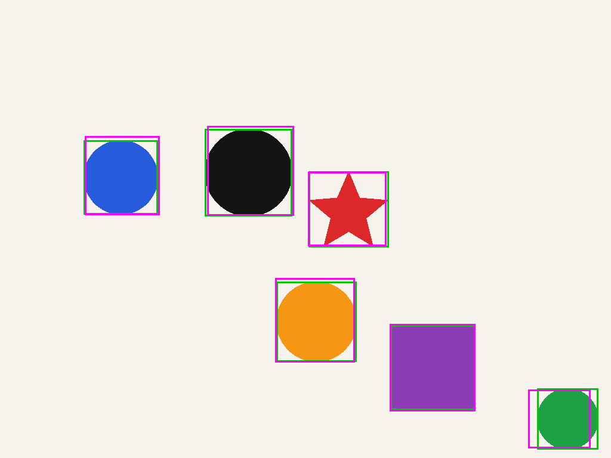

# 👀 The vision probe — what can they actually see?

Six of our models accept images. That sounds great until you ask "how well?", and the honest
answer is "we had to check". So we drew twelve pictures with a known right answer, showed them
to every image-capable model, and graded the replies field by field.

## The pictures

All twelve are generated by [`bench/vision/gen_images.py`](../bench/vision/gen_images.py) from
fixed seeds, so the set is identical every time you make it. Three per category:

| Category | What's in the picture | What we grade |
|---|---|---|
| 🧾 **OCR** | Three invoices. The third one is a fake "scan": rotated 1.5°, blurred, greyscale | invoice number, date, total, and every line's description, quantity and amount |
| 🟥 **Bounding boxes** | 4–6 coloured circles, squares, triangles and stars | each shape: right shape, right colour, and a box that overlaps the true one by IoU ≥ 0.5 |
| 📊 **Understanding** | a bar chart, a field of red and blue dots, a 3×3 grid of shapes | chart reading (±2), counting, "what's directly left of the black square?" |
| 📐 **CAD** | Three dimensioned engineering drawings of plates with holes, plus a title block | width, height, hole count, diameter, pitch, edge offsets, part number, material |

No agent, no tools: one image and one question go straight to the model's chat API, and the
answer has to be JSON. Each model uses its own vision projector and launcher defaults.

## The results

| Model | 🧾 OCR | 🟥 Boxes in pixels (as asked) | 🟥 Boxes, any format | 📊 Understanding | 📐 CAD | **Overall** | Time per image |
|---|---:|---:|---:|---:|---:|---:|---:|
| [**Gemma 4 26B-A4B**](models/gemma4-26b-a4b.md) | 100% | 0% | 100% | 100% | 100% | **100%** | 71 s |
| [**Qwen3.6-35B-A3B**](models/qwen3.6-35b-a3b.md) | 100% | 7% | 100% | 100% | 100% | **100%** | 44 s |
| [Ornith-1.5-35B-A3B](models/ornith-1.5-35b-a3b.md) ² | 100% | 13% | 87% | 100% | 100% | **97%** | 34 s |
| [Bonsai 2 27B](models/bonsai2-27b.md) | 100% | **67%** | 100% | 100% | 93% | **98%** | 38 s |
| [Nemotron 3.5 Bolt 74B](models/nemotron-bolt-74b.md) | 100% | 21% | 64% | 100% | 100% | **91%** | 115 s |
| [Qwen3-VL-8B](models/qwen3-vl-8b.md) | 100% | 7% | 100% | 61% | 96% | **89%** | **6 s** |
| [Qwen3.8 distill](models/qwen3.8-35b-a3b-distill.md) | 100% | 13% | 87% | 67% | 100% | **88%** | 36 s |
| [Groot-19B-A3B](models/groot-19b-a3b.md) ¹ | 97% | 21% | 21% | 78% | 100% | **74%** | 49 s |

"Overall" counts boxes in whatever coordinate format the model chose (more on that in a second).
Measured 2026-10-23 (¹ 2026-10-26, ² 2026-10-27), one answer per image. Flint, Spark and the Nemotron E4B are text-only, so they
sat this one out.

<p align="center"><br><em>Gemma's boxes (magenta) over the truth (green). Not bad for a model that refused to use pixels.</em></p>

## What we learned

**OCR is a solved problem here.** All six read every field on every invoice, the blurry rotated
"scan" included. If you need text out of an image, any of them will do; Qwen3-VL will do it in
six seconds.

**Everyone can find the shapes. Almost nobody uses the coordinates you ask for.** We asked for
pixel coordinates. Gemma answered on a 0–1000 grid: under its own `box_2d` key with *y before x*,
and under the requested `bbox` key with x first. The Qwen models used `bbox_2d`, also on a
0–1000 grid. Taken literally, that's a score near zero.
Converted from their native format, the boxes are good (mean overlap 0.77–0.91, the overlay
above). Only Bonsai 2 (two of three images) and Bolt 74B (one) used pixels as asked. If you build anything on
detection: ask for each model's native format, or convert from it. That's why the table has two
box columns, one for "did what it was told" and one for "can actually see".

**Thinking helps with counting.** Qwen3-VL doesn't reason before answering, which makes it 6 to 19
times faster than the rest, and it shows in the details: it counted 12 blue dots instead of 11,
miscounted the bars above 50 on the chart, and misplaced one shape in the grid. The reasoning
models got the understanding questions right, except the distill, which miscounted both colours
(8 red and 12 blue, for 7 and 11).

**Engineering drawings are surprisingly readable.** Sizes, hole callouts, part number, material:
nearly perfect across the board. The only slips came on one plate where three dimension labels
sit close together (`20`, `2x 30`, `25`): Qwen3-VL read the pitch as 20, Bonsai read both the
pitch and the edge offset as 25.

**Speed is mostly where the projector lives.** Qwen3-VL keeps its vision encoder on the GPU and
doesn't think: 6 seconds per image. The others encode images on the CPU (no VRAM to spare next to
a 20 GB model) and reason first: 36 to 71 seconds, and 115 for the 74B Bolt, whose 1.7 GB
projector is the biggest of the lot.

**Bigger isn't better at boxes.** Bolt 74B, the largest model here, read the invoices, chart,
dots, grid and drawings perfectly, then drew the worst boxes: right x positions and top edges,
bottoms about twice as low as they should be. Its 64 % "any format" box score is the lowest of the
six; Bonsai 2, about a third of its size, used pixels as asked and scored 100 %.

## Run it yourself

```bash
python3 bench/vision/gen_images.py               # regenerate the 12 images
bash scripts/stop-server.sh                      # it needs the GPU to itself
python3 bench/vision/run_vision.py               # all six models, ~1.5 hours; resumable
python3 bench/vision/run_vision.py qwen3vl       # just one
```

Answers, scores and box overlays land in `bench/vision/results/`. Details in
[`bench/vision/README.md`](../bench/vision/README.md).

## Fine print

Twelve images, one answer each: this is a probe, not a leaderboard. One wrong field moves a
category by several points. The pictures are synthetic and clean (well, except that one "scan"),
which is great for exact grading and kinder than real photos.
