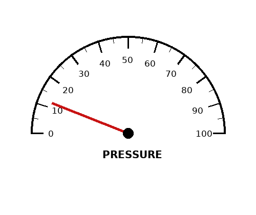
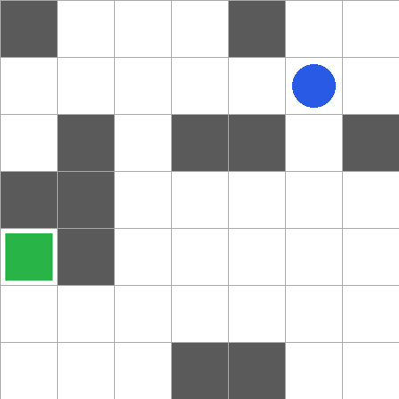

# 🕹️ The visual control probe — can a small vision model act on what it sees?

The [vision probe](vision-probe.md) asks "what's in this picture?". This one asks the next
question: look at a picture, decide, and **call a tool**. It's the job a small vision model
would do inside a bigger system: watch a dial and open a valve, find a button and click it,
steer a robot. [LFM3-VL-2B](models/lfm3-vl-2b.md) failed pibench (0/18) by looping on tool
calls, and its card says it isn't meant for multi-turn work, so we built a test that fits what
it *is* meant for, and ran [Qwen3-VL-8B](models/qwen3-vl-8b.md) through it for comparison.

Everything lives in [`bench/visual-control/`](../bench/visual-control/): the script, the results,
and [notes.md](../bench/visual-control/notes.md) with what the models actually said.

## The tests

**glance: one picture, one decision.** Five kinds of scene, each with its own tools, drawn from a
seed so the right answer is known:

| Scene | The picture | The rule | Tools |
|---|---|---|---|
| 🛢️ tanks | three tanks with fill levels | refill any tank below 30%; none low → no call | `refill(tank)` |
| 🖱️ click | a dialog with five buttons | click the named button; not there → no call | `click(x, y)` |
| 🤏 pick | 4–6 shapes on a table | pick up "the green circle", "the leftmost object"… | `pick(x, y)` |
| 🚦 signal | a traffic light, sometimes a person on the crosswalk | red or a person → stop, yellow → slow down, green → go | `stop`, `slow_down`, `go` |
| ⏲️ gauge | a pressure dial | above 70 open the valve, below 20 close it, else report the reading | `open_valve`, `close_valve`, `report(value)` |

Some scenes need no call at all (no tank is low, the button isn't there), so "always call
something" doesn't score.

**grid: a closed loop.** A blue robot, a green goal and (in half the episodes) 11 dark wall cells
on a 7×7 grid. The model calls `move(direction)` once per step and gets the new picture back,
up to twice the shortest path plus 8 steps. Two ways to run it:

- **stateless**: every step is a fresh request: the picture, the rules and the last few moves as
  text ("right, down (blocked), …"). The harness keeps the state.
- **history**: one growing conversation, a new picture after each move.

<p align="center"> <br><em>A gauge scene and a grid with walls.</em></p>

**Safe to run.** The model only produces tool calls. They are parsed with `json.loads`, checked
against the tool's schema and applied to a pure-Python simulation: nothing it writes is run, saved
to a path it picked, or sent anywhere. The only network traffic is to the local llama-server.

We also tried **forcing a call** (`tool_choice: required`): the model must answer with a tool
call, and it gets an extra `no_action(reason)` tool so it can still decline.

## The results

RTX 2070 Max-Q (8 GB), both models with their vision projector on the GPU, measured 2026-10-28/29.
Full tables: [`results/summary.md`](../bench/visual-control/results/summary.md).

**glance** (v2 scenes; 12 per kind, the "30" rows have 30 per kind):

| Model | Thinking | Forced call | 🛢️ | 🖱️ | 🤏 | 🚦 | ⏲️ | **All** | Per decision |
|---|---|---|---:|---:|---:|---:|---:|---:|---:|
| [LFM3-VL-2B](models/lfm3-vl-2b.md) | on | | 12 | 12 | 12 | 12 | 12 | **60/60** | 2.9 s |
| LFM3-VL-2B | on | ✓ | 12 | 12 | 12 | 11 | 12 | **59/60** | 2.6 s |
| LFM3-VL-2B, 30 | on | ✓ | 25 | 30 | 29 | 30 | 30 | **144/150** | 2.7 s |
| LFM3-VL-2B | off | | 12 | 11 | 11 | 7 | 4 | **45/60** | 0.4 s |
| LFM3-VL-2B | off | ✓ | 12 | 12 | 10 | 12 | 4 | **50/60** | 0.4 s |
| LFM3-VL-2B, 30 | off | ✓ | 24 | 30 | 26 | 27 | 10 | **117/150** | 0.4 s |
| [Qwen3-VL-8B](models/qwen3-vl-8b.md) | (none) | | 8 | 12 | 11 | 12 | 8 | **51/60** | 1.0 s |
| Qwen3-VL-8B | (none) | ✓ | 8 | 12 | 11 | 12 | 6 | **49/60** | 1.0 s |
| Qwen3-VL-8B, 30 | (none) | ✓ | 18 | 30 | 29 | 30 | 17 | **124/150** | 0.9 s |

**grid** (8 open episodes, 8 with walls):

| Model | Thinking | Forced call | Memory | Open | Walls | Steps without a move | Blocked moves | Per step |
|---|---|---|---|---:|---:|---:|---:|---:|
| LFM3-VL-2B | on | | stateless | **8/8** | **3/8** | 77/229 | 6 | 44 s |
| LFM3-VL-2B | on | ✓ | stateless | **8/8** | **3/8** | 90/243 | 8 | 43 s |
| LFM3-VL-2B | on | | history | 6/8 | 2/8 | 58/274 | 27 | 39 s |
| LFM3-VL-2B | off | | stateless | 3/8 | 0/8 | 157/318 | 50 | 0.7 s |
| LFM3-VL-2B | off | ✓ | stateless | 6/8 | 0/8 | 4/280 | 167 | 0.3 s |
| LFM3-VL-2B | off | | history | 5/8 | 0/8 | 148/308 | 45 | 2.5 s |
| LFM3-VL-2B | off | ✓ | history | 0/8 | 0/8 | 218/354 | 36 | 4.1 s |
| Qwen3-VL-8B | (none) | | stateless | **8/8** | 1/8 | 0/283 | 67 | 0.7 s |
| Qwen3-VL-8B | (none) | ✓ | stateless | **8/8** | 0/8 | 0/278 | 73 | 0.7 s |
| Qwen3-VL-8B | (none) | | history | 4/8 | 2/8 | 68/274 | 71 | 1.6 s |

## What we learned

- **With thinking on, LFM3-VL-2B is a good one-shot decider.** 60/60, and 144/150 on the bigger
  set, at under 3 s a decision on 2.6 GB of VRAM. It reads dials and tanks within a few units and
  applies the rules. Its one systematic miss: when two or three tanks are low, it plans every
  refill and emits only the first call.
- **Without thinking it sees but doesn't decide.** It reads the gauge correctly and then calls
  `report` whatever the value, and says `go` on yellow lights. It also never makes more than one
  call per answer. At 0.4 s it's fine for "where is X?", not for "what should I do?". One cheap
  fix we found: just *offering* a `no_action` tool ("call this when none of the other tools
  should be used") takes the traffic light from 19/30 to 29/30, though it never calls it there.
  The gauge doesn't improve.
- **Qwen3-VL-8B (no thinking, 1 s a decision) is accurate but over-eager**: it refills tanks that are half full
  and misapplies the gauge thresholds. Click, pick and signal are near perfect.
- **Stateless beats history, for both models.** With its own previous answers in the context
  LFM3-VL starts copying them: in the history grid it pasted the same paragraph at every step,
  the pibench loop in miniature (with thinking on it doesn't, but it doesn't do better either: 6/8 and 2/8). Qwen3-VL stopped one cell short of the goal, said "the robot is
  on the green square", and kept saying it for up to 18 steps while every new picture showed
  otherwise. Let the harness keep the state and ask one fresh question per step.
- **Mazes are hard for both.** With thinking, LFM3-VL solves 3 of 8 and rarely bumps a wall, but
  it re-maps the whole grid at every step and a third of the steps run out of the 6,000-token
  thinking budget before any call. Qwen3-VL wanders in four-move cycles; LFM3-VL without thinking
  walks into the same wall again and again (23 times in a row, with "down (blocked)" in every
  prompt).
- **`tool_choice: required` in llama.cpp isn't a guarantee.** The grammar lets the model write text
  before the call, so a model that starts talking can run to `max_tokens`: in the history grid 203
  of 354 forced replies were text. With thinking, the grammar only starts after the reasoning, so
  it can't help when the budget runs out. And the `no_action` escape hatch gets misused ("I need
  to identify the bottommost object before picking it").
- **Check the test before blaming the model.** Our first glance version had a pick scene where
  "topmost" was a matter of 7 px, and prompts that said "give the point" instead of "use the
  click tool". The thinking model took that literally and wrote coordinates as text. v2 fixed
  both and LFM3-VL went from 52 to 60/60; the v1 results are in `results/v1/`.

**Verdict:** LFM3-VL-2B with thinking makes a good set of eyes plus a reflex: one picture, one
tool call, a harness that keeps the state. Don't hand it a conversation or a maze.

## Run it yourself

```bash
systemd-run --user --scope --unit=llama-lfm3vl -E QMODEL=lfm3vl bash scripts/run-qwen.sh --image
python3 bench/visual-control/run_control.py glance lfm3vl --think on
python3 bench/visual-control/run_control.py grid lfm3vl --think on --memory stateless
python3 bench/visual-control/run_control.py summary
```

`--tool-choice required` forces a call, `--n` sets the number of scenes or episodes, and
`examples` saves one picture of each scene.
